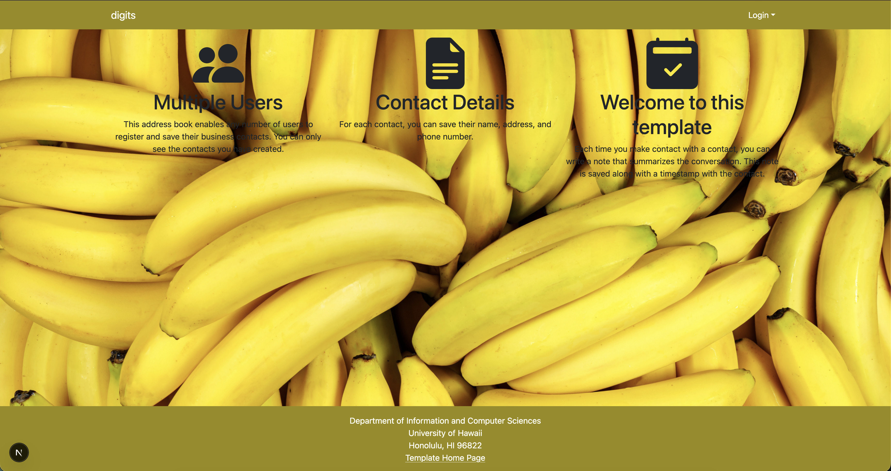

# Installation

1. Run `createdb digits` to create a database. 
    

2. Edit the `.env` file and change `DATABASE_URL` to its appropriate value. It must follow this outline.
    ```
    DATABASE_URL="postgresql://<user>:<password>@<host>:5432/<databaseName>?schema=public"
    ```

3. Run `npx prisma migrate dev` to update the database with the required schema.

4. Run `npx prisma generate` to generate the datatables into the database.

5. Seed the database with `npx prisma db seed`
6. Login as user or an admin with the following information 
    * email: john@foo.com password: changeme
    * email: admin@foo.com password: changeme
